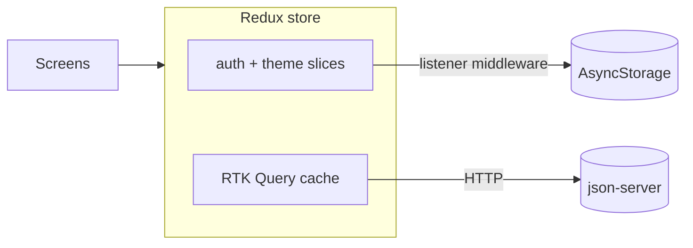

<div align="center">


# Voy — Flight App

Search flights, save favorites and check flight details, in light or dark mode.<br>
Built with Expo, TypeScript, Redux Toolkit and React Navigation.

</div>

## Quick start

```bash
npm install
npm run server      # terminal 1: mock API on port 3000
npx expo start      # terminal 2: the app
```

Log in with **`demo@flights.com`** / **`123456`**, then try **TIA → FCO** with a departure date between **10 Nov and 24 Dec 2026**.

The app finds the mock API automatically from the Expo dev server's address. To use another server, set `EXPO_PUBLIC_API_URL` in `.env` (see `.env.example`).

<details>
<summary><b>Running on an Android phone over USB</b></summary>
<br>

```bash
adb reverse tcp:8081 tcp:8081
adb reverse tcp:3000 tcp:3000
npx expo start -c --localhost   # then press a
```

</details>

## Features

- **Login** with mocked authentication
- **Flight search** with airport autocomplete; origin and destination can't be the same
- **Recent searches**: newest first, max 5, no duplicates, tap to prefill, saved between restarts
- **Search results** with pull-to-refresh; tap a flight for details, or add it to favorites
- **Favorites**: optimistic add and remove, with a confirmation dialog, saved per user
- **Flight details**: times, aircraft, gate, terminal, duration, price and status
- **Navigation**: bottom tabs (Home, Favorites, Profile, More) with nested stacks
- **Light and dark theme**: follows the system by default, and the choice is remembered

## Tech stack

| Area | Choice |
| --- | --- |
| Framework | React Native + **Expo** |
| Language | TypeScript (strict) |
| State | **Redux Toolkit** only: RTK Query + `auth` and `theme` slices |
| Navigation | React Navigation (native stack + bottom tabs) |
| Backend | json-server |
| Tests | Jest + React Native Testing Library |

**Why Expo:** no native setup, it runs on a real phone through Expo Go, and the app needs no custom native code.

## Project structure

```
src/
├── app/          Redux store and typed hooks
├── services/     Base RTK Query API
├── navigation/   Root stack, tabs, nested stacks, route types
├── theme/        Colors, theme slice, theme hooks
├── components/   Shared UI (Button, Card, TextField, DateField, ConfirmDialog…)
├── features/     auth, search, flights, favorites, profile, more
├── types/        Domain types
└── utils/        Date helpers
server/           db.json (live data) and db.seed.json (clean copy)
```

Code is grouped **by feature**: each feature keeps its screens, components, API endpoints and logic together. Screens handle data and navigation; the small components inside each feature only display what they receive as props.

## Architecture



- **State:** server data (flights, favorites, recent searches) lives in the RTK Query cache. Each feature adds its endpoints to one base API with `injectEndpoints`. Only app-wide client state (`auth`, `theme`) uses slices; screen-only state stays in `useState`.
- **Caching:** after a change, the app updates the RTK Query cache directly instead of refetching. Favorites update optimistically and roll back if the request fails; a new recent search is added to the cached list once the server confirms it. So adding a favorite is one request, and a search is one save plus the flights request.
- **Navigation:** the root stack shows Login or the tabs based on auth state, so you can't navigate back into the app after logging out. Each tab has its own stack, and all routes are typed.
- **Persistence:** listener middleware saves the session and theme to AsyncStorage, so reducers stay pure. Both are restored before the first render, so nothing flashes on startup.
- **Theming:** custom light and dark themes extend React Navigation's themes, so headers and the tab bar follow automatically.

## Trade-offs

| Decision | Why | In production |
| --- | --- | --- |
| json-server mock backend | Fast to set up, no API keys | A real flights API behind the same endpoints |
| Mock login | Allowed by the brief | Tokens in secure storage |
| Recent-search rules in the app | json-server has no server logic | Enforced by the backend |
| Results filtered by departure date | The arrival date marks the end of the trip and is saved with the search | Also show return flights |
| Mock data covers TIA routes only | Realistic, fixed data with statuses and gates | Real flight data |

## Scripts

| Command | What it does |
| --- | --- |
| `npm run server` | Start json-server on port 3000 |
| `npm run server:reset` | Reset the data (stop the server first) |
| `npm test` | Run the unit and component tests |
| `npm run lint` | Run ESLint |

## Troubleshooting

| Problem | Fix |
| --- | --- |
| No data loads | Check `npm run server` is running, then restart with `npx expo start -c` |
| "No flights found" | Use a TIA route and a date between 10 Nov and 24 Dec 2026 |
| Phone over USB stops loading | Reconnect the cable and run both `adb reverse` commands again |

## Next steps

- Connect a real flights API and real authentication
- Show return flights for the arrival date
- End-to-end tests and CI